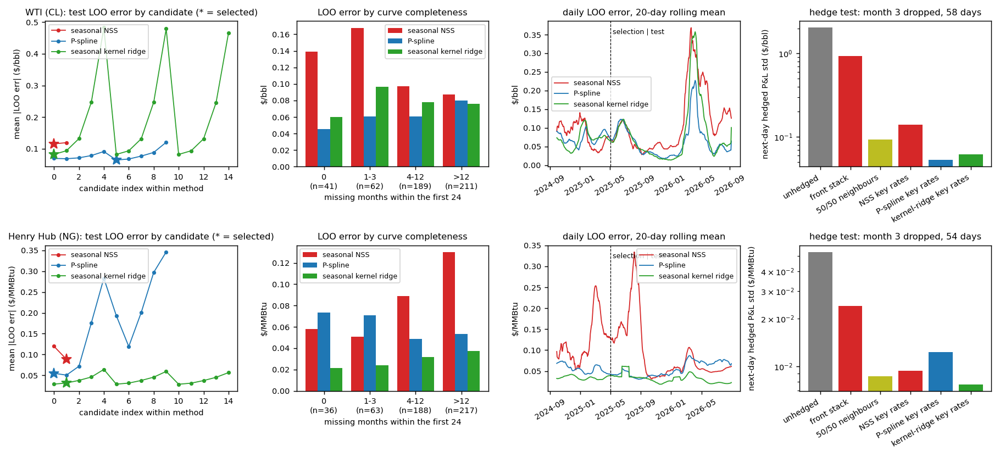
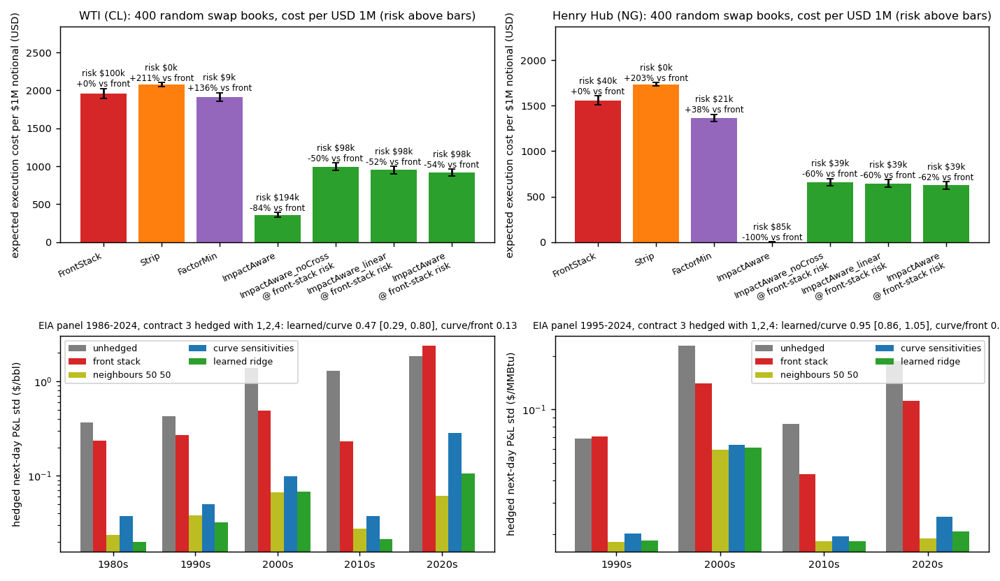

# commodity-etrading-stack

A pricing, hedging and quoting stack for calendar-month WTI and Henry Hub swaps, in header-only C++20 behind one CLI (`cetk`) with a numpy reference port (`python/cetk`): seasonal futures curves, a factor risk model, price impact fitted from hourly bars, an impact-aware hedger, and an RFQ engine with closed-form quotes and a FIX 4.4 gateway. All data is free (EIA, CFTC, Yahoo) and checked in.

The question: do recent curve, impact and quoting models beat a swap desk's classical answers out of sample?

## Results

- **Curves.** Over 503 / 504 daily builds (2024-09-17 to 2026-09-17; settings chosen on the first third, scored on the rest), the P-spline cuts WTI's leave-one-out repricing error 26% [18, 33] against a seasonal Nelson–Siegel–Svensson (0.065 vs 0.116 $/bbl). The seasonal kernel ridge cuts Henry Hub's 52% [49, 54] (0.031 vs 0.089 $/MMBtu).
- **Key-rate hedges.** A month-3 contract dropped from the curve and hedged with its key-rate sensitivities leaves a next-day P&L std of 0.053 $/bbl and 0.0077 $/MMBtu, against 0.93 and 0.024 for a front-month stack.
- **Impact.** Hourly order-flow impact is concave: δ = 0.21 [0.17, 0.24] for WTI and 0.22 [0.20, 0.24] for gas. Cross-impact lifts the explained variance of hourly returns from 0.36 to 0.43 (WTI) and from 0.45 to 0.52 (gas).
- **Hedging.** In the fitted impact model, an impact-aware hedge at the front stack's residual risk costs 54% [52, 57] less per $1M on 400 random WTI swap books, and 62% [60, 64] less on gas. Hedging back to a risk band every 30 minutes in the RFQ simulator, the two cost the same (212 and 213 $ per $1M on WTI): the saving is a large-book effect.
- **Quoting.** On a replay of 480 real days, skewing quotes by inventory with the closed form adds 10.7 [1.6, 20.8] $k/day (13%) over symmetric quotes on WTI. On gas it leaves P&L unchanged (-1.0 [-11.3, +5.0]) and cuts the 5-minute P&L std 10%. EIA inventory surprises and CFTC hedging pressure predict nothing out of sample (|correlation| ≤ 0.08).

| | WTI | Henry Hub |
|---|---|---|
| repricing error, seasonal NSS → best curve | 0.116 → 0.065 $/bbl | 0.089 → 0.031 $/MMBtu |
| impact exponent δ, 1 h [95% CI] | 0.21 [0.17, 0.24] | 0.22 [0.20, 0.24] |
| hedge cost per $1M at equal risk: front stack → impact-aware | 1,961 → 918 | 1,557 → 624 |
| skewed minus symmetric quotes, real-day replay ($k/day) | +10.7 [+1.6, +20.8] | -1.0 [-11.3, +5.0] |




All numbers are in `results/summary.md`; the detail is in [docs/method.md](docs/method.md).

## How it works

$$F(T,\phi) = a + bT + \sum_j w_j\,k_{\mathrm{Sob}}(T,T_j)\,k_{\mathrm{per}}(\phi,\phi_j)$$

$$h^\ast = \arg\min_h\ \mathrm{cost}(h) + \gamma\,\tau\,(q+h)^\top\Sigma\,(q+h)$$

- **Calendar.** NYMEX expiry rules for both contracts. A calendar-month swap settles on the business-day average of the prompt contract, so its legs span two contracts around expiry.
- **Curves.** A seasonal NSS, a cubic P-spline and a seasonal kernel ridge (a Sobolev kernel in time to expiry $T$ times a periodic kernel in the delivery month's phase $\phi$, after Filipović–Pelger–Ye). All three are linear in prices, so leave-one-out errors and key-rate sensitivities are exact.
- **Impact and hedging.** Power-law self-impact and ridge cross-impact from tick-rule signed volume on hourly bars, bootstrapped over days. The hedge $h$ for a swap book $q$ minimises spread and impact cost plus risk under the factor covariance $\Sigma$, dialled to the front stack's residual risk before costs are compared.
- **RFQ engine.** Client tiers with logistic hit probabilities; quotes from the Bergault–Evangelista–Guéant–Vieira closed form, widened for informed flow (Barzykin–Bergault–Guéant) and before EIA releases; a 5-minute market with release jumps, an exact P&L decomposition, mark-outs, limits and a kill switch. FIX 4.4 fills are asserted identical to the in-process engine.

## Limitations

- There is no free history of full futures curves: Yahoo lists only live contracts, so the curve is complete on only 41 (WTI) and 36 (gas) days since September 2024. Every curve result is reported by completeness.
- Order flow is a tick-rule proxy on hourly bars, not order-book data.
- RFQ flow is simulated, since no public dealer RFQ data exists; the replay takes only the market path and release times from real days.
- The hedging saving is relative to the impact model fitted here.

## Run

```
cmake -S . -B build -G Ninja && cmake --build build && ./build/cetk_tests    # 180 known-answer checks
pip install -e .[test] && python -m pytest                                 # 15 tests
scripts/run_all.sh --skip-download                                         # the pipeline on the checked-in data
```

The README and `docs/method.md` are written by `scripts/readme.py` from `results/`. CI builds and tests the C++, runs a short pipeline, and checks both files against the results.
