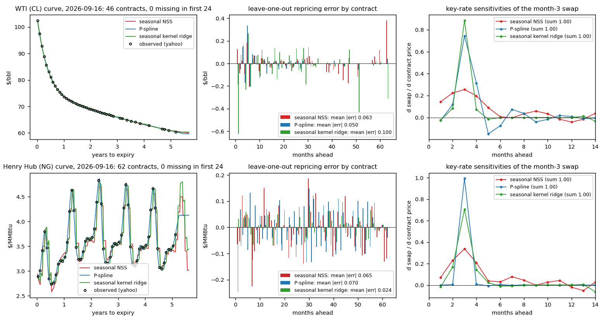
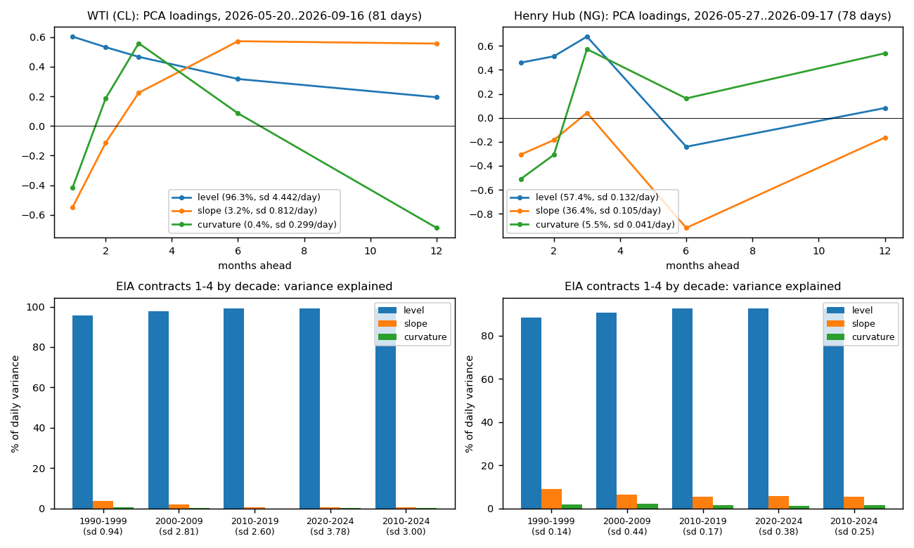
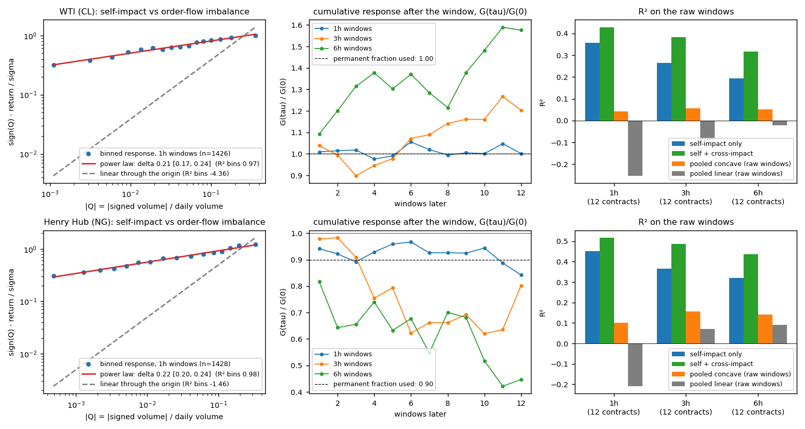
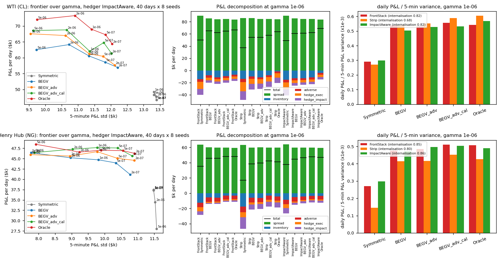
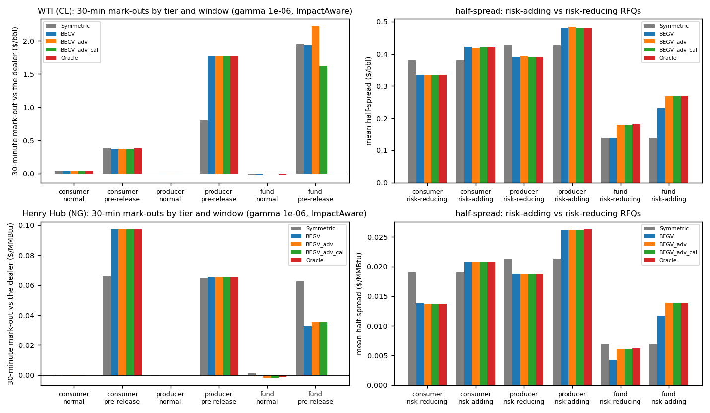
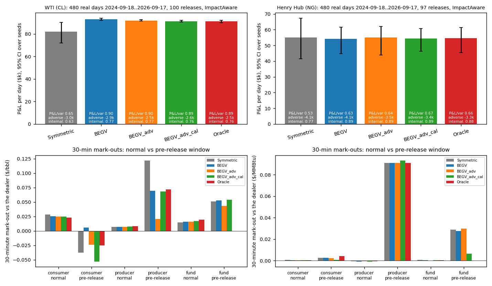
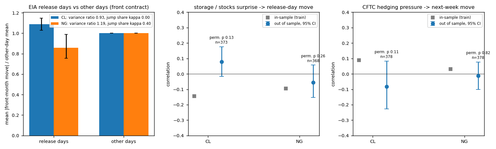

# commodity-etrading-stack: method and full results

**Question.** A commodity swap desk quoting calendar-month WTI and Henry Hub swaps by RFQ needs a futures curve to price off (including the months no contract trades), hedge ratios for a book of swaps, an execution policy for the hedge that respects price impact, and a quoting rule that survives informed flow around the weekly EIA releases. Does the recent research — seasonal kernel-ridge and P-spline curves (Filipović–Pelger–Ye kernels), nonparametric cross-impact (Hey–Neuman–Tuschmann), impact-aware hedging, and the Barzykin–Bergault–Guéant closed-form multi-asset quotes with adverse-selection and calendar widening — improve on the desk's classical answers (seasonal Nelson–Siegel–Svensson, a front-month stack or strip, symmetric spreads) when each is tested out of sample on free public data and, for quoting, in an RFQ simulator with an exact P&L decomposition and a replay of the real 2024–2026 days?

Literature cut-off October 2025. Header-only C++20 behind one CLI (`cetk`), a FIX 4.4 RFQ gateway (`cetk_fixgw`) whose fills are asserted identical to the in-process engine, and a numpy port of the curve engine, calendar and factor model (`python/cetk`) as the independent reference. 180 C++ known-answer checks, the FIX self-test and 15 Python tests; CI builds with g++, runs all of it and a short pipeline on the committed data, checks that the Python rebuild of a day's curves agrees with the C++ it just built, and checks the README and this page against `results/` (`python scripts/readme.py --check`).

---

## Layout

| path | what |
|---|---|
| `tools/download.py`, `tools/build_curves.py` | free data (EIA, Yahoo chart API, CFTC) → `data/raw/`; daily curves and hourly bar panels → `data/derived/` (committed, so everything below runs without downloads) |
| `include/cetk/calendar.hpp` | NYMEX expiry rules (WTI: 3 business days before the 25th of the prior month; Henry Hub: 3 business days before the delivery month), n-th delivery, years to expiry, seasonal phase |
| `include/cetk/curve.hpp` | seasonal NSS (τ grid, two annual harmonics), cubic P-spline (second-difference penalty), seasonal kernel ridge (Sobolev cubic × periodic kernel); leave-one-out, extrapolation, hat-matrix key-rate sensitivities; calendar-month swaps and strips |
| `include/cetk/factors.hpp`, `linalg.hpp` | PCA (Jacobi) of the ladder, covariance at any tenors; ridge solves, symmetric powers |
| `include/cetk/impact.hpp` | Hey–Neuman–Tuschmann-style estimation from bars: pooled power-law self-impact, ridge cross-impact, block bootstrap over days, cumulative decay; the `ImpactModel` the hedger and simulator use (`configs/impact_*.json`) |
| `include/cetk/hedge.hpp` | policies FrontStack, Strip, FactorMin, ImpactAware (coordinate descent on the exact cost with the kink at zero), ablations without cross terms / linear; `hedge_to_risk` (log-bisection on γ) for equal-risk comparisons; the random-book experiment |
| `include/cetk/clients.hpp`, `quoter.hpp` | client tiers (consumer / producer / fund) with logistic hit probabilities and intensity seasonality; Symmetric, BEGV closed form, `_adv` (tier widening), `_adv_cal` (pre-release widening), Oracle |
| `include/cetk/engine.hpp`, `risk.hpp`, `toxicity.hpp` | the RFQ engine: 5-minute market on the factor model with a hidden informed direction, release-day jumps, transient and permanent own impact, mark-outs, exact P&L decomposition, band hedging, internalisation, toxicity classifier (EKF logistic) with routing, anticipatory hedging, position / risk / drawdown limits with a kill switch, common random numbers; the real-day replay |
| `include/cetk/fix.hpp`, `src/fix_gateway.cpp` | FIX 4.4 session layer and RFQ application messages (QuoteRequest / Quote / NewOrderSingle / ExecutionReport); `--serve` and the identical-fills `--selftest` |
| `src/main.cpp` → `cetk` | `curve`, `curvehist`, `factors`, `impact`, `hedge`, `sim`, `events`, `price`, `datacheck` |
| `tools/hedge_test.py`, `tools/event_features.py` | learned vs curve hedge ratios on the 1986–2024 EIA panel; release calendar, storage / stocks surprises, hedging pressure → `data/derived/events_*.csv`, `results/events_study_*.json` |
| `tools/api.py`, `tools/fix_client.py`, `tools/record_snapshot.py` | REST front end over `cetk price`; a Python FIX client for the gateway; the daily full-curve recorder |
| `python/cetk/` | `calendar.py`, `curve.py`, `factors.py`: numpy port agreeing with the C++ to a few 10⁻⁶ on a day's fits; `data.py`, `results.py`, `stats.py`; `python -m cetk curve|compare|summary` |
| `python/tests/`, `tests/tests.cpp` | pytest: expiry rules, models on synthetic curves, sensitivities sum to one, swap weights, PCA signs, bootstrap and ridge, every model number of the committed C++ curve build re-derived; C++: calendar, models, swaps, factors, impact on synthetic bars, hedging at equal risk, quoter identities, engine decomposition / CRN / mark-outs / routing / limits, FIX round trip and loopback |
| `scripts/run_all.sh`, `plots.py`, `summarize.py`, `report.py`, `readme.py` | pipeline, figures, `results/summary.md`, `report.pdf`, the README and `docs/method.md`; `notebooks/results.ipynb` |

Build: `./build.ps1` (MSVC + Ninja) or `cmake -S . -B build -G Ninja && cmake --build build`; `python -m pytest` (`PYTHONPATH=python` or `pip install -e .[test]`). Python: `numpy matplotlib fpdf2 xlrd` (xlrd only for the EIA spreadsheets).

---

## Data

There is no free source of historical *full* futures curves, and the plan said so before any code was written. What exists, and what the stack does with it:

| layer | source | coverage | use |
|---|---|---|---|
| front contracts 1–4, daily settlements | EIA (NYMEX via EIA, spreadsheets) | WTI 1983-03 – 2024-04-05, Henry Hub 1993-12 – 2024-04-05 | long-history factor model by decade, learned-vs-curve hedge test, release-day study |
| every listed contract, daily closes | Yahoo chart API (`CLX26.NYM`, …), 2y range | 2024-09 – 2026-09, contracts listed today only | daily curve builds; a contract that has since expired is missing on past dates, so the curve is complete only from the last expiry (2026-07-21 WTI, 2026-07-29 gas) and every day records `gap_months`, the missing delivery months within the first 24 |
| continuous front `CL=F` / `NG=F` | Yahoo, daily | 2024-09 – 2026-09 | month 1 on every day (median difference to the EIA front on the overlap 0.000) |
| hourly bars per listed contract | Yahoo, 730d range | 2024-09 – 2026-09, the last 90 days used | impact estimation (the twelve nearest deliveries, 76 trading days, ~1,430 hourly windows) |
| weekly storage / crude stocks; release calendar | EIA | 1994– / 1982– | release days, surprises (vs a seasonal-mean nowcast), the jump share of release-day variance |
| Commitments of Traders, disaggregated | CFTC | 2010–2026 | hedging pressure (Kang–Rouwenhorst–Tang) |
| daily full-curve snapshots | `tools/record_snapshot.py` | from the day it is first run | grows the complete-curve history one day at a time |

Curve completeness since September 2024 (WTI / gas): 41 / 36 complete days, 62 / 63 with 1–3 missing months, 189 / 188 with 4–12, 212 / 217 with more than 12; the first complete day is 2026-07-21 (WTI) / 2026-07-29 (gas). Every curve result is reported by completeness class. The hedge test uses the consecutive days on which every contract of the first day is still quoted on the next.

---

## Method

**Calendar.** WTI's delivery-month contract expires three business days before the 25th of the prior month (the 25th moved back to a business day); Henry Hub's three business days before the delivery month. A calendar-month swap settles on the business-day average of the prompt contract, so a December WTI swap is 65 % January and 35 % February; a Henry Hub calendar month is the single next-month contract except in months whose contract expires early. Legs whose contract is not observed are priced off the model and flagged.

**Curve models** (all linear in prices, so leave-one-out, extrapolation and sensitivities are exact hat-matrix identities). With $T$ years to expiry and $\phi$ the seasonal phase of the delivery month:
- seasonal NSS: $F(T,\phi) = \beta_0 + \beta_1 e^{-T/\tau_1} + \beta_2 \tfrac{T}{\tau_1}e^{-T/\tau_1} + \beta_3 \tfrac{T}{\tau_2}e^{-T/\tau_2} + \sum_{h=1}^{H}\big(a_h\cos 2\pi h\phi + b_h \sin 2\pi h\phi\big)$, $(\tau_1,\tau_2)$ on a grid, $H \in \{2,3\}$;
- P-spline: cubic B-splines with knots every 1 or 2 months and a second-difference penalty $\lambda\sum(\Delta^2 c)^2$;
- seasonal kernel ridge: $F(T,\phi) = a + bT + \sum_j w_j\,k\big((T,\phi),(T_j,\phi_j)\big)$ with $k = k_{\text{Sob}}(T,T')\,k_{\text{per}}(\phi,\phi')$, $k_{\text{Sob}}(s,t) = \min(s,t)^2(3\max(s,t)-\min(s,t))/6$ (Filipović–Pelger–Ye) and $k_{\text{per}} = \exp\!\big(-2\sin^2(\pi(\phi-\phi'))/\ell^2\big)$, ridge $\lambda$.

Candidates (NSS $H$; P-spline knots × $\lambda \in [10^{-4}, 1]$; kernel ridge $\ell \in \{0.2, 0.35, 0.5\}$ × $\lambda \in [10^{-5}, 10^{-1}]$) are scored by leave-one-out repricing on the first third of the daily builds; the best per model is fixed and scored on the remaining two thirds. Key-rate sensitivities $\partial F(T^\ast)/\partial P_i$ are the hat-matrix row (NSS with the shape frozen); they sum to one. Hedge test: the month-3 contract is dropped, repriced off the curve built from the rest and hedged with the other contracts using that curve's sensitivities; the realised next-day P&L of the package is the score.

**Factors.** PCA of daily changes of the fitted curve on the $\{1,2,3,6,12\}$-month ladder (recent window, days with at most two missing months) and of the EIA front panel by decade; $\Sigma = \sum_k \lambda_k L_k L_k^\top$ at the ladder in \$/contract-unit per day.

**Impact.** For each hourly window and contract $i$: $Q_i$ = tick-rule signed volume / average daily volume, $R_i$ = log return / its std. Pooled self-impact $\text{sign}(Q)\,R = Y|Q|^\delta$ fitted in log–log on 16 volume bins; $\delta$'s 95 % CI by block bootstrap over days; cross-impact by ridge of $R_j$ on $\text{sign}(Q_i)|Q_i|^\delta$ for all $i$ (self-only vs full R² on the raw windows); the response after the window $G(\tau)/G(0)$ gives the transient decay rate and the permanent fraction. The simulator's `ImpactModel` (σ, daily volume, $Y$, $\Lambda$, decay, permanent fraction, half-spreads) is restricted to the ladder.

**Hedging.** For a swap book $q$ (contracts on the ladder) the hedge $h$ minimises $\text{cost}(h) + \gamma\,\tau\,(q+h)^\top\Sigma(q+h)$ where the cost is spread + transient impact $\sum_j \sigma_j Y_j |h_j/V_j|^{\delta} |h_j|$ + permanent cross-impact $\tfrac12 h^\top \Lambda h$-type terms, all in dollars; coordinate descent with a golden-section line search and the kink at zero. FrontStack puts the whole delta in month 1, Strip hedges each month one for one, FactorMin minimises the factor risk only. For the comparison every policy's cost is evaluated under the full model, and the impact-aware hedge and its ablations (no cross terms; linear impact) are dialled by log-bisection on $\gamma$ to the front stack's residual risk, so the saving is at equal risk; 400 random books, bootstrap CIs.

**Quoting** (half-spread $\delta$ in \$/unit; tier hit probability $f_i(\delta) = 1/(1+e^{\alpha_i+\beta_i\delta})$):
- Symmetric: $f_i(\delta_i) = h^\ast$ per tier.
- BEGV closed form: exponential intensities fitted at $\arg\max_\delta \delta f(\delta)$, $D_j = A_j \bar z k_j / e$, $\Gamma = D^{-1/2}\big(D^{1/2}\tfrac{\gamma}{2}\Sigma D^{1/2}\big)^{1/2} D^{-1/2}$ (so $\Gamma D \Gamma = \tfrac{\gamma}{2}\Sigma$, tested), $\delta_j^{\pm} = \tfrac{1}{k} + \tfrac12 \Gamma_{jj} z \mp (\Gamma q)_j$.
- `BEGV_adv`: plus each tier's expected adverse move $\mu_i$ over the holding period (the Barzykin–Bergault–Guéant treatment of informed flow); `BEGV_adv_cal`: plus a fixed widening in the 30 minutes before a scheduled release; Oracle: the true $\mu_i$ and $p_i\,E|\text{jump}|$ — the closed form given the client model.

**Simulator.** Poisson RFQs per (tier, tenor, side) with seasonal intensity, sizes 10 / 25 / 50 / 100 contracts; a fill moves inventory and earns $z\,\delta$ per unit; the market moves on a 5-minute grid from the factor model with a hidden informed direction that switches at rate 0.5/day and drifts the curve (0.6 \$/bbl/day WTI, 0.03 \$/MMBtu/day gas, scaled by the level loadings), which the fund tier trades with; release days add a jump at the release time (half at once, half over 30 minutes); the dealer's own hedges move the market with the fitted transient and permanent impact; the book is hedged every 30 minutes to a risk band by the chosen policy. Exact decomposition: spread + inventory + adverse + hedge execution + hedge impact = total, residual $10^{-7}$. Mark-outs at 5 / 30 / 60 minutes by tier and window, a toxicity classifier (EKF logistic on mark-outs) with optional routing of toxic RFQs, anticipatory hedging (Nutz–Webster–Zhao), position / risk / drawdown limits with a kill switch. Common random numbers: every quoter sees the same market and the same RFQ script. The replay uses the real 2024-09 – 2026-09 days: the front contract follows the realised close-to-close change (Brownian bridge intraday, the release jump at the release time), the rest of the ladder moves with the factor model.

---

## Results

Figures from `scripts/plots.py`; tables in `results/summary.md`; the run in `report.pdf`.

### Curve: three models on 503 / 504 daily builds

| | WTI (CL) | Henry Hub (NG) |
|---|---|---|
| test-period LOO repricing error, seasonal NSS | 0.116 $/bbl (0.16%) | 0.089 $/MMBtu (2.63%) |
| P-spline (selected: lambda=0.0001 knots=2m / lambda=0.0001 knots=1m) | **0.065 (0.09%), -26% [-33, -18]** | 0.055 (1.56%), -6% [-12, 0] |
| seasonal kernel ridge (selected: lambda=1e-05 ell=0.2 / lambda=0.0001 ell=0.2) | 0.082 (0.11%), -19% [-27, -11] | **0.031 (0.87%), -52% [-54, -49]** |
| test-period extrapolation error, last three contracts (NSS / P-spline / KR) | 0.213 / 0.107 / 0.152 | 0.056 / 0.172 / 0.034 |
| hedge test, month-3 contract dropped, next-day P&L std (58 / 54 days; unhedged / front stack / 50-50 neighbours / NSS / P-spline / KR key rates) | 2.03 / 0.925 / 0.0923 / 0.139 / 0.0526 / 0.062 | 0.0531 / 0.024 / 0.00864 / 0.00936 / 0.0122 / 0.00769 |

The two markets want different machines. WTI's curve is smooth and nearly seasonless, so a P-spline with a light penalty wins and the seasonal kernel's extra flexibility costs it at the front. Henry Hub's curve is a strong annual wave, so the periodic kernel is the right prior: the seasonal NSS with two or three harmonics cannot follow the winter peaks and the P-spline has to bend through them month by month. On the 1986–2024 EIA panel (contracts 1–4 only) the curve's key rates are no better than a 50/50 neighbour hedge (WTI 0.115 vs 0.047 $/bbl; gas 0.040 vs 0.037) and a ridge learned on a trailing window sits between (0.055 / 0.038; learned-over-curve ratio 0.47 [0.29, 0.80] WTI, 0.95 [0.86, 1.05] gas): with four points a curve has nothing to add, and the modern hedge test above is where the curve earns its keep.

### Factor risk

The first factor explains 96% of the daily ladder variance for WTI (81 days) and is a level shift; for Henry Hub (78 days) it explains 57% and is not parallel — the 6-month contract loads with the opposite sign because the winter and summer contracts move apart — and the second factor carries another 36%. Three factors explain over 99% of both. On the 1990–2024 EIA front contracts, four adjacent months, the level share is 96–99% for crude and 89–93% for gas in every decade.

### Impact from hourly bars

| window | WTI δ [95% CI] | gas δ [95% CI] | R² self-only → self + cross (WTI / gas) |
|---|---|---|---|
| 1 h (1,426 / 1,428 windows, 76 days, 12 contracts) | 0.206 [0.174, 0.241] | 0.216 [0.196, 0.241] | 0.357 → 0.428 / 0.451 → 0.517 |
| 3 h | 0.371 [0.302, 0.462] | 0.354 [0.312, 0.411] | 0.264 → 0.384 / 0.365 → 0.486 |
| 6 h | 0.413 [0.300, 0.716] | 0.430 [0.309, 0.590] | 0.194 → 0.316 / 0.320 → 0.435 |

The concave power law fits the binned one-hour response with R² 0.975 (WTI) and 0.982 (gas); a line through the origin has R² -4.36 and -1.46 on the same bins. The exponent is low at one hour (the flow-imbalance proxy is noisy at that resolution) and rises toward the 0.4–0.5 the literature reports at longer horizons. After the window the WTI response does not decay (the estimate is treated as permanent); the gas response decays to 0.90 of the concurrent level.

### Hedging swap books at equal risk

| policy (WTI, 400 books, γ = 5e-07) | cost per $1M notional [95% CI] | residual risk | vs front stack [95% CI] |
|---|---|---|---|
| front stack | 1,961 [1,897, 2,026] | $100k | — |
| strip (one for one) | 2,075 [2,048, 2,101] | 0 | +211% [+32, +443] |
| factor-minimum | 1,915 [1,861, 1,970] | $9k | +136% [+4, +320] |
| impact-aware, unconstrained | 361 [331, 390] | $194k | -84% [-85, -83] |
| impact-aware, no cross terms @ front-stack risk | 996 [943, 1,046] | $98k | -50% [-53, -48] |
| impact-aware, linear impact @ front-stack risk | 955 [904, 1,003] | $98k | -52% [-55, -50] |
| **impact-aware @ front-stack risk** | **918 [868, 967]** | **$98k** | **-54% [-57, -52]** |

Henry Hub: front stack 1,557 per $1M at $40k residual risk; impact-aware at the same risk 624 [584, 663], -62% [-64, -60]; ablations -60% / -60%. The saving comes from splitting the hedge across contracts where the book's risk actually sits instead of dumping it into the front month (the concave cost makes many small clips cheaper than one large one); the cross terms and the concavity are each worth 1.8 to 4.0 points on top.

### Quoting: the closed forms in the simulator and on the real days

Synthetic days: 40 days × 8 seeds, common random numbers, so the differences between cells are paired; the levels carry ±$10–20k/day of inventory noise, the paired differences do not. Risk aversion γ = 1e-06, hedger impact-aware to a $100k band.

| quoter, WTI | P&L/day $k | vs Symmetric, paired [95% CI] | 5-min std $k | daily P&L / 5-min var ×10⁻³ | adverse $k/day | fund hit ratio |
|---|---|---|---|---|---|---|
| Symmetric | 49.3 | — | 13.31 | 0.30 | -4.5 | 0.41 |
| BEGV (skew) | 60.6 | +11.3 [+1.0, +20.4] (+23%) | 11.33 | 0.50 | -3.6 | 0.30 |
| BEGV_adv (+ tier widening) | 61.2 | +12.0 [+1.4, +21.1] (+24%) | 11.34 | 0.53 | -3.1 | 0.22 |
| BEGV_adv_cal (+ pre-release widening) | 62.1 | +12.8 [+0.4, +23.3] (+26%) | 11.35 | 0.53 | -3.2 | 0.22 |
| Oracle (true client model) | 69.0 | +19.7 [+8.1, +30.1] (+40%) | 11.41 | 0.57 | -3.1 | 0.22 |

| quoter, Henry Hub | P&L/day $k | vs Symmetric, paired [95% CI] | 5-min std $k | daily P&L / 5-min var ×10⁻³ | adverse $k/day | fund hit ratio |
|---|---|---|---|---|---|---|
| Symmetric | 37.5 | — | 11.48 | 0.30 | -5.7 | 0.39 |
| BEGV | 44.7 | +7.2 [+0.5, +13.8] (+19%) | 9.81 | 0.47 | -5.8 | 0.34 |
| BEGV_adv | 46.7 | +9.2 [+2.3, +15.6] (+25%) | 9.77 | 0.50 | -4.8 | 0.28 |
| BEGV_adv_cal | 47.7 | +10.2 [+4.9, +15.5] (+27%) | 9.78 | 0.50 | -4.6 | 0.28 |
| Oracle | 47.0 | +9.5 [+3.0, +15.8] (+25%) | 9.89 | 0.49 | -4.8 | 0.27 |

Over γ the skewed quoters move up and to the left together — at γ = 5e-06 the WTI `BEGV_adv_cal` book earns 68.6 $k/day at a 9.6 $k 5-minute std against 62.1 / 11.4 at 1e-06 — while the symmetric quoter stays at 48.3 / 13.3 (against 49.3 / 13.3): with quotes that do not depend on the book, γ only changes the hedge. The widening features do what they are meant to (fund hit ratio 0.41 → 0.22, adverse -4.5 → -3.2 $k/day for `BEGV_adv_cal`) but the informed drift the data support is small next to the spread, so their P&L is a few $k/day. Hedgers (`BEGV_adv_cal`, paired vs the front stack): WTI strip -7.0 [-15.2, +0.7] $k/day at 2.1× the hedge cost (16.0 vs 7.6 $k/day), impact-aware -2.6 [-5.4, -0.0] at 7.7; gas strip -6.0 [-9.8, -2.6], impact-aware -0.6 [-3.4, +2.6]. Halving or doubling the impact model scales the band-hedging cost (front stack 115 / 212 / 395 $ per $1M on WTI, impact-aware 115 / 213 / 396) and the two stay level. Variants at γ = 1e-06 for `BEGV_adv_cal`: anticipatory hedging (hedge the EWMA of recent signed flow before it arrives) +6.1 [-0.7, +13.0] $k/day and -12% std on WTI, +2.7 [+1.0, +4.9] on gas; toxicity routing -6.3 [-18.2, +4.8] for the symmetric quoter and +4.0 [-0.4, +8.8] for the skewed one on WTI (61 RFQs externalised), no RFQ externalised on gas.

Real days: 480 days from 2024-09-18 to 2026-09-17 with 100 (WTI) / 97 (gas) EIA release days, 3 seeds of client flow, impact-aware hedger.

| quoter | WTI P&L/day $k | vs Symmetric, paired | 5-min std | P&L / var ×10⁻³ | gas P&L/day $k | vs Symmetric | 5-min std | P&L / var ×10⁻³ |
|---|---|---|---|---|---|---|---|---|
| Symmetric | 82.2 | — | 11.31 | 0.65 | 55.1 | — | 10.37 | 0.53 |
| BEGV | 92.9 | +10.7 [+1.6, +20.8] (+13%) | 10.18 | 0.90 | 54.1 | -1.0 [-11.3, +5.0] (-2%) | 9.34 | 0.63 |
| BEGV_adv | 91.9 | +9.7 [+1.2, +19.5] (+12%) | 10.12 | 0.90 | 55.2 | +0.0 [-7.7, +5.4] (+0%) | 9.40 | 0.64 |
| BEGV_adv_cal | 91.2 | +9.0 [+0.4, +18.6] (+11%) | 10.14 | 0.89 | 54.5 | -0.6 [-10.8, +4.8] (-1%) | 9.07 | 0.67 |
| Oracle | 91.2 | +9.0 [-0.4, +20.2] (+11%) | 10.15 | 0.89 | 54.7 | -0.5 [-10.3, +4.8] (-1%) | 9.11 | 0.66 |

On the real path the skew is the whole story: +13% P&L and +39% P&L per unit variance on WTI (`BEGV` against `Symmetric`); on gas the skewed quoters leave P&L unchanged and cut the 5-minute std 9–13%. The fund tier's 30-minute mark-out is +0.015 $/bbl on a normal WTI RFQ and +0.051 in the 30 minutes before a release (n = 121 under symmetric quotes, against a 14-cent half-spread) — the informed pre-release flow is there, but it is a small share of the flow: the widening cuts those fills from 121 to 53 and its P&L effect is inside the noise. The gas replay says the same (+0.029 → +0.006 $/MMBtu on 109 → 40 fills).

### Releases: what the EIA history says

| | WTI (crude stocks, Wednesday) | Henry Hub (storage, Thursday) |
|---|---|---|
| release days / other days | 1,999 / 7,638 | 768 / 6,860 |
| release-day variance ratio, jump share κ | 0.93, 0.00 | 1.19, 0.40 |
| surprise → release-day move, out of sample (2020–24) | corr +0.08 [-0.02, +0.18], p = 0.13 | corr -0.06 [-0.15, +0.06], p = 0.26 |
| hedging pressure → next-week move, out of sample | corr -0.08 [-0.23, +0.08], p = 0.11 | corr -0.01 [-0.10, +0.08], p = 0.82 |

A crude inventory release is not an event for the daily variance of WTI (variance ratio 0.93); a storage release is for gas (1.19), and 40% of that day's variance sits in the jump. Neither the inventory surprise measured against a seasonal-mean nowcast (the free substitute for the analyst consensus) nor the CFTC positioning predicts anything out of sample; both are reported and neither is used by a quoter.

---

## Validation

- Calendar: `CLX26` expires 2026-10-20, `NGX26` 2026-10-28, `CLV26` 2026-09-22 (tests, and the same rules in Python); the December WTI swap is 15 January + 8 February business days.
- Every curve model reprices its own inputs within the ridge; key-rate sensitivities sum to one; the P-spline penalty orders smoothness; LOO and extrapolation are computed by refitting, and the candidate selection was fixed on the first third of the days before the test numbers were seen.
- Two implementations of the curve: the C++ that produced the numbers and an independent numpy port compared number by number on the committed day (`python -m cetk compare`: a maximum difference of a few 10⁻⁶; it fails beyond 10⁻⁴ of the mean price) and in CI on the day it just built.
- Impact: on synthetic bars generated with exponent 0.5 and known cross terms the estimator recovers a concave exponent, its bootstrap band contains the point estimate, and the cross terms add explanatory power only when they are there; the decay is a cumulative response, not a lag correlation.
- Hedging: the equal-risk cells sit within 3 % of the front stack's residual risk; the ablations use the same books and seeds; bootstrap CIs over books.
- Quoting: $\Gamma D\Gamma = \tfrac{\gamma}{2}\Sigma$ to $10^{-6}$; quotes skew the right way; the decomposition sums to the total to $10^{-7}$; identical quotes on the same seed give identical P&L; the fund tier's 30-minute mark-outs are more favourable to the client than the consumers'; the adverse widening is wider for the fund tier and wider again before a release; the kill switch and the position limit fire when they should; the FIX loopback produces the same fills and P&L as the in-process run (`cetk_fixgw --selftest`).
- 180 C++ checks, 15 Python tests, CI on every push.

## Traps stated

- *No free curve history.* The daily builds cover two years and are complete only from July 2026; the completeness class is on every table, and the hedge test uses only consecutive days on which every contract is still quoted. `tools/record_snapshot.py` is the fix, one day at a time.
- *Client flow is simulated.* The quoting results measure what the closed forms do in a stated client model, not desk P&L; the replay borrows only the real market path and release times.
- *Impact from bars, not ticks.* Tick-rule signed volume on hourly bars is a proxy for order-flow imbalance; the low one-hour exponent is partly that noise. The hedge-cost saving is model-relative: the dollar numbers move with the model, the ranking survives halving or doubling it (`sim_impact_half`, `sim_impact_double`).
- *P&L levels are noisy; differences are not.* Forty days × eight seeds leaves ±$10–20k/day on a level; all quoter and hedger comparisons are paired on the same seeds. Spreads come from the assumed client hit model (half-spreads of roughly 40 c/bbl and 4 c/MMBtu on the closed forms), not from a real desk's flow, so the P&L levels are stylised.
- *Yahoo is a convenience feed*: unofficial, rate-limited, and the intraday history is ephemeral (730 days), which is why the derived bars are committed.

## References

- Filipović, Pelger, Ye (2022) *Stripping the discount curve — a robust machine learning approach*, [arXiv:2206.05002](https://arxiv.org/abs/2206.05002).
- Hey, Neuman, Tuschmann (2025) *Nonparametric estimation of cross-impact* — the estimation design followed here, [arXiv:2510.06879](https://arxiv.org/abs/2510.06879); Tomas, Mastromatteo, Benzaquen (2021) *Cross-impact in multi-asset markets*, [arXiv:2102.02834](https://arxiv.org/abs/2102.02834).
- Bergault, Evangelista, Guéant, Vieira (2021) *Closed-form approximations in multi-asset market making*, [arXiv:1810.04383](https://arxiv.org/abs/1810.04383).
- Barzykin, Bergault, Guéant (2023, 2024) *Dealing with multi-currency inventory risk in FX cash markets* and *Market making in spot precious metals*, [arXiv:2404.15478](https://arxiv.org/abs/2404.15478); Barzykin, Bergault, Guéant, Lu (2025) *Market making with informed flow*, [arXiv:2508.20225](https://arxiv.org/abs/2508.20225).
- Nutz, Webster, Zhao (2025) *Anticipatory hedging under price impact*; Cartea, Jaimungal, Sánchez-Betancourt on toxicity and mark-outs — implemented as described in the project plan.
- Kang, Rouwenhorst, Tang (2020) *A tale of two premiums: the role of hedgers and speculators in commodity futures markets*, Journal of Finance 75(1).
- Seasonal curve studies: the TTF curve comparison in *Energies* (2023); [arXiv:2501.15596](https://arxiv.org/abs/2501.15596), [arXiv:2503.18199](https://arxiv.org/abs/2503.18199).
- Data: EIA petroleum and natural-gas spreadsheets; CFTC disaggregated Commitments of Traders; Yahoo Finance chart API.
